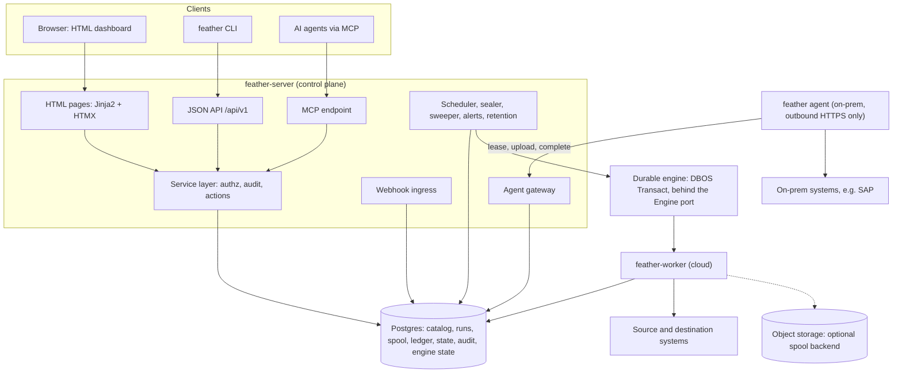
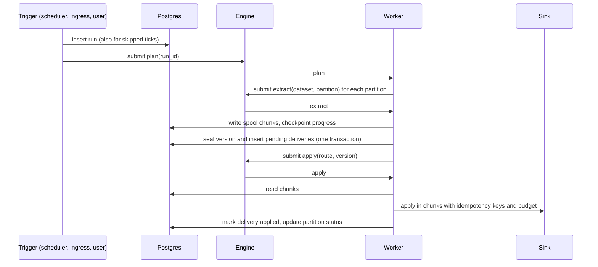
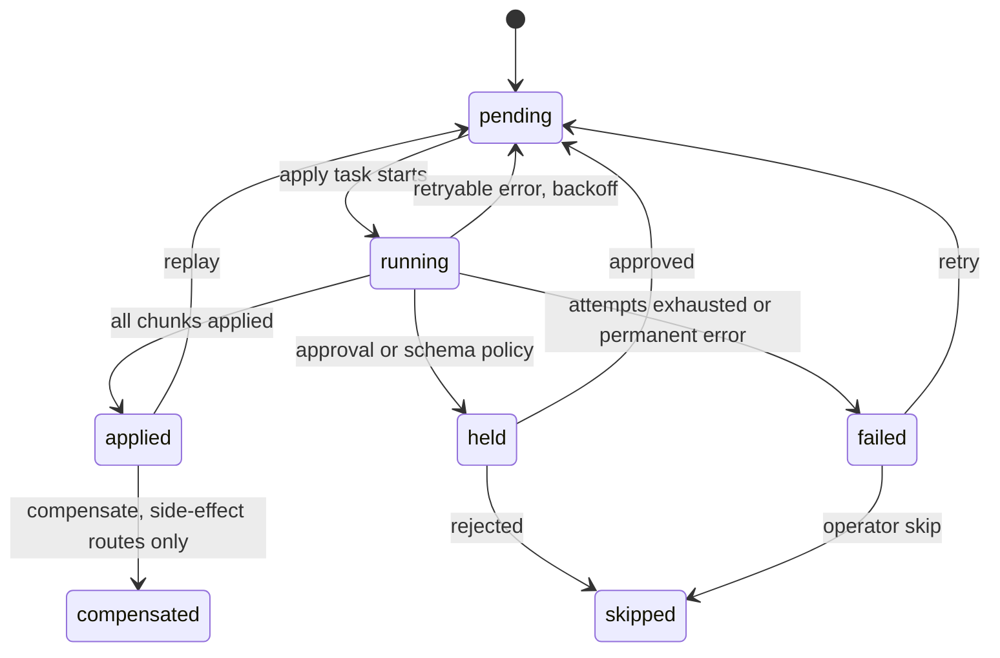
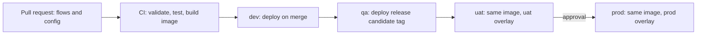

# Feather Connect — Design Specification

> SDLC phase 2 of 7 · Version 0.2 (draft for review) · 30 October 2026
> Owner: Abdul Sukkur · Prepared with Claude Code
> Implements: [Discovery v0.2](../01-discovery/2026-10-30-feather-connect-discovery.md) · Decisions: [ADRs](../adr/README.md)

| Version | Date | Author | Change |
|---|---|---|---|
| 0.1 | 2026-10-30 | Abdul Sukkur, with Claude Code | First complete draft, including the sponsor's directions: HTML-only front end, Postgres as the database |
| 0.2 | 2026-10-30 | Abdul Sukkur, with Claude Code | Phase 3 spike results applied: DBOS chosen (ADR-0003), the engine port reshaped to what the spike validated, DBOS operating rules (§6.12), invariant I10, confirm-later sinks, spool sizing, connector findings |

Review status: **awaiting sponsor review.** Requirement ids (FR-…, NFR-…) refer to the discovery document; §21 maps them to the sections below.

---

## 1. Scope of this document

This specification describes how Feather Connect v1.0 (milestones M1–M3) is built:
- architecture and the core data model;
- the SDK, runtime and storage;
- connectors, interfaces and the dashboard;
- environments, tenancy and security;
- AI operability and observability;
- testing, the repository, deployment and the delivery plan.

Decisions with lasting consequences are recorded as ADRs in [`docs/adr`](../adr/README.md). The durable engine is DBOS Transact (ADR-0003), and the design keeps it behind a small port (§6.8).

## 2. Design principles

1. **Deep modules.** Interfaces are small and the machinery stays hidden behind them. Behaviour beyond the defaults is added through hooks, never through a growing list of flags.
2. **Code is the source of truth for flows.** Operational state lives in the control plane, and every runtime knob change is audited.
3. **One model for batch and events.** A nightly ERP extract and a webhook posting use the same concepts.
4. **Extraction never waits for delivery.** Reads land in the spool first.
5. **Ids in messages, data in storage.** Engine payloads carry identifiers, never records.
6. **Same powers, same rules for humans and agents.** Every action goes through one service layer, with one RBAC model and one audit trail.
7. **Boring infrastructure.** Postgres is the only required database. Everything else is optional.
8. **The engine is replaceable.** Our data model, ledger and dashboard don't depend on it.
9. **Everything that happens is recorded, and everything recorded is actionable.** No silent skips.
10. **Safe by default in prod.** Impact previews, reasons, approvals, least privilege.
11. **HTML first.** The dashboard is server-rendered HTML with no single-page-app framework and no Node build, so the codebase stays Python-only.

## 3. Architecture



| Component | Responsibility | Technology | Scales by |
|---|---|---|---|
| `feather_connect` SDK | Flow and connector APIs; runtime (plan, extract, apply); test harness; `LocalEngine` | Python ≥ 3.12, pyarrow, httpx, Pydantic | Library |
| `feather-server` | HTML dashboard, JSON API, MCP endpoint, webhook ingress, agent gateway, scheduler, sealer, sweeper, alert evaluator, retention | FastAPI, Jinja2, HTMX, psycopg 3, Alembic | Replicas behind a load balancer; singleton loops elect a leader with a Postgres advisory lock |
| `feather-worker` | Loads flow packages, registers them in the catalogue, executes tasks | SDK + engine adapter | Replicas; labels route work |
| `feather agent` | Executes tasks for systems reachable only on-prem; connects out only | SDK + agent client | One or more per site |
| Engine | Durable task execution: queueing, durable waits, concurrency keys, step checkpoints | DBOS Transact, a library inside each worker, behind `DbosEngine` (ADR-0003) | Worker replicas and polling interval (§6.12) |
| Postgres | **The only required database**: catalogue, runs, spool, ledger, record state, audit, and the engine's state | Postgres ≥ 15, no extensions | Vertical; partitioned tables |
| Object storage | Optional spool backend for bulk-heavy datasets and long archives | S3-compatible, Azure Blob, GCS | Elastic |

**Rules of communication:**
- Browsers, the CLI and agents (AI or on-prem) talk only to `feather-server`.
- Workers talk to Postgres, the engine and external systems. They never call the dashboard.
- On-prem agents connect out over HTTPS to the agent gateway only. They hold no database, engine or object-storage credentials.
- The engine carries ids, never data.

## 4. Core data model

### 4.1 Concepts

| Concept | Definition | Example |
|---|---|---|
| Connector | Code that knows how to read from and/or write to a system | `sap`, `zoho.zakya`, `postgres` |
| Connection | A configured connector instance in one environment and tenant; secrets by reference | `sap` in prod for tenant `default` |
| Dataset | A named stream of keyed records from one source entity, with a key, partition scheme and change strategy | `zakya.invoice` |
| Record | One keyed document: the unit of identity and storage. It carries `key`, `op` (upsert/delete), `payload` and `row_hash`. | Invoice INV-1001 with its lines |
| Partition | A named business slice derived from record fields, with an explicit timezone. It is used to plan, re-run, verify and backfill, **not** to store. | `store_id=1509/date=2026-10-18` |
| Version | An immutable batch of upserts and deletes for one dataset partition, from one extraction, with a manifest (counts, hashes, watermark, run, code version).<br>• A **complete** version describes the whole slice and may imply deletes.<br>• An **incomplete** version carries only explicit deletes. | v42 of `zakya.invoice` for `store_id=1509/date=2026-10-18` |
| Run (epoch) | One execution of a flow; every version records the run that produced it | run `01JD…` |
| Route | A path from a dataset to a destination: optional transform, sink, mode and priority | `sap.price → zakya` |
| Delivery | The application of one version to one route. The ledger of deliveries is each route's cursor **and** its dead-letter state. | v42 → `zakya`: applied |
| Flow | The deployable unit: the datasets it reads, the routes it delivers to, and its triggers | `sap-price-to-channels` |
| Budget | A named, shared rate limit with windows and priority reserves | `zoho-api`: 90/min and 24,000/day |
| Hold | Work paused for a human decision | A dropped column on `sap.material` |
| Override | An audited runtime change to an operational knob | Pause route `magento` until 18:00 |
| Readiness | "Complete through T" for a dataset or group | Sales ready through 2026-10-18 |

### 4.2 Invariants

These hold for every flow. Tests in §16 check each one.

- **I1.** A sealed version is immutable.
- **I2.** A route applies the versions of one (dataset, partition) in seal order. Version n+1 is not applied until version n is applied or skipped.
- **I3.** A delivery (route, version) reaches `applied` at most once. The ledger prevents re-application, and sinks are idempotent by key, so a crash between the sink call and the ledger write cannot duplicate effects.
- **I4.** Only complete versions imply deletes (keys missing from the slice). Incomplete versions delete only through explicit delete records.
- **I5.** Extraction never waits for a route. A destination outage only grows that route's backlog.
- **I6.** Every trigger, including a skipped tick, creates a run record with a reason.
- **I7.** Records are keyed by business identity. Partitions are derived from record fields with an explicit timezone. A record whose partition changes is an update, not a new record.
- **I8.** Engine task arguments carry ids only. Data lives in the spool.
- **I9.** Every action by a human, an agent or the system is authorised, audited and attributed.
- **I10.** Deletes implied by complete versions are decided after every slice of the run has been read. A key absent from one slice but present in another slice of the same run is a move, not a delete.

### 4.3 Change strategies

| Strategy | How it reads | Version | Deletes | Use for |
|---|---|---|---|---|
| `by_stamp(field, lookback)` | Rows changed since the last watermark, minus the lookback | Incomplete | Explicit (tombstones or soft-delete flags), or through `reconcile` | Tables and APIs with a reliable change timestamp |
| `snapshot_diff()` | The whole partition. Skips it if the slice hash is unchanged; otherwise diffs row hashes against the previous snapshot. | Complete | Implicit (keys missing from the slice) | Stampless tables, hard-deleting sources, masters |
| `replace()` | The whole partition, delivered as-is | Complete | Implicit | Small masters and files, where reloading is cheaper than diffing |
| `push()` | Events arriving by webhook or CDC, micro-batched (§6.3) | Incomplete | Explicit events | Webhooks, CDC |
| Custom | Your `Strategy` implementation | Either | Either | Anything else |

- **No-op suppression.** Records whose `row_hash` matches the last known state are dropped from the version, so lookback re-reads don't churn destinations. The last known state comes from record state when `keep_state=True`, and otherwise from the row hashes of versions whose watermark falls within the lookback window.
- **Empty-read guard.** A complete read that returns no rows would delete the whole slice, so it fails unless the dataset sets `allow_empty=True`. A transient empty API response must not wipe a destination.
- **Reconcile.** Any incremental dataset can schedule a periodic `snapshot_diff` over recent partitions, for example `reconcile=fc.reconcile(every="7d", partitions="last 90 days")`. This catches hard deletes and back-dated rows that change stamps miss.
- **Partition hash snapshots.** `snapshot_diff` keeps one compact snapshot per partition: each record's key and a 64-bit row hash, stored as a Parquet chunk in the spool. The key is needed to emit delete records. The diff is an anti-join between the new snapshot and the previous one inside the worker. A 100-million-row stampless table therefore costs 8 bytes of hash per row plus its compressed key, plus the changed rows. Spike S4 measured 16.5 bytes per row with a 64-bit key hash in place of the key, and 0.34 s to diff 1 million rows.
- **Run-level delete reconciliation (I10).** A run that reads one slice seals its version when the read finishes. When a run reads several slices in full:
  - Each `extract` task stages its version, along with its candidate deletes: keys in the previous snapshot and missing from the new one.
  - When the last slice finishes, a `seal_run` task compares the candidates with every new snapshot of the run. A candidate found in another slice is a move, so it is dropped as a delete and the upsert records `moved_from`.
  - `seal_run` then seals all of the run's versions in one transaction.
  - Sealing slice by slice would delete and re-insert a record that moved between slices (spike S2, case H1b). That is harmless for a warehouse, but wrong for a side-effect route, where an ERP posting could be reversed and re-posted.
  - The cost is that a multi-slice run delivers nothing until every slice has been read. A failed slice keeps the run open until it is retried or an operator abandons the run.

### 4.4 Partitions

- **Schemes:**
  - `none()` (the default);
  - `by_day(field, tz)` and `by_month(field, tz)`;
  - `by_fields("store_id", by_day("date", tz))`, which composes schemes;
  - `by_bucket(field, n)`, a hash bucket that adds parallelism while keeping per-key order;
  - a custom `Planner`.
- **Canonical key.** Each partition has a canonical key such as `store_id=1509/date=2026-10-18`. The dashboard shows it in business words: "Store 1509 · 18 Oct 2026".
- **Planning:**
  - A scheduled run plans its window (for example today and yesterday in the flow's timezone, plus the lookback).
  - A backfill plans an explicit range, previewed first.
  - An event plans the partitions it touches.
- **Record moves.** With `keep_state=True`, a record whose partition changes (an edited invoice date, a document moved between plants) produces an upsert in the new partition. It also produces a *move notice* for the old one: `replace_partition` routes remove the record from the old slice, and `upsert` routes need nothing because they are keyed. This is hard case H1 in §16.

### 4.5 Route modes

| Mode | Semantics | Requirement |
|---|---|---|
| `upsert` (default) | Insert or update by key; deletes delete (or tombstone, per sink) | Keyed destination |
| `append` | Every record is appended with `_fc_key`, `_fc_op`, `_fc_version`, `_fc_run`, `_fc_extracted_at` and `_fc_partition` columns, so full history is kept | Bronze and history tables |
| `replace_partition` | Atomically replace the destination's slice | Complete versions; a transactional destination |
| `side_effect` | Business operations (post a sale, create an order). `apply` must be idempotent through an idempotency key or a content-keyed duplicate guard. `compensate` reverses. | The sink implements both; an optional approval policy |

A `snapshot_diff` dataset with a `replace_partition` route also stores the whole slice, in chunks of kind `full`, because its version otherwise holds only the changes.

**Approvals.** A route may declare an approval policy: always, per environment, or a predicate per record. Records that need approval go to a hold, and the rest of the version proceeds. Approved records are applied in order. Rejected records are marked skipped, with the reason.

### 4.6 Readiness and consistent cuts

- Each (dataset, partition) has a `complete_through` marker. It comes from a complete version, or from a source watermark event (for example, the POS reports a store-day closed).
- A **readiness group** is a set of datasets. The group is ready through T when every member is complete through T with versions from runs that started at or after the group's cut, so the data forms a consistent cut across datasets.
- `fc.on_ready(group, through="day")` triggers once per period per group. A typical use is a store-day sales posting that runs only after invoices, returns and payments are all complete.
- Readiness gates only the flows that ask for it, and never blocks unrelated routes. This avoids the header/line coupling found in the reference evaluation.

### 4.7 Schemas and evolution

- A dataset may declare its schema as a Pydantic model or an Arrow schema. Otherwise the schema is inferred and recorded per version as `schema_hash`.
- Default evolution policy, per route:
  - added columns and widened types apply automatically;
  - dropped columns, narrowed types and type changes create a `schema_change` hold.
- The policy can be overridden per dataset or route: `"strict"`, `"permissive"` or a custom function.
- Records that fail validation are **quarantined** with a reason and the rest of the version proceeds. Setting `on_record_error="fail"` makes the whole version fail instead.

### 4.8 Record state

With `keep_state=True`, the latest payload, row hash, partition and last version per key are kept in Postgres. Record state powers:
- no-op suppression;
- move detection;
- **supersede**, where a quarantined record is resolved automatically once a newer version of the same key applies;
- record trace;
- bootstrapping a newly added route.

It is off by default for bulk datasets, where versions and the warehouse already keep history.

## 5. Flow-as-code SDK

### 5.1 Flow project layout

A flow project is an ordinary Python package in git. One project can serve every environment.

```text
acme-flows/
├── feather.yaml            # project name, flow modules, defaults
├── env/
│   ├── dev.yaml            # per-environment overlays (§5.6)
│   ├── qa.yaml
│   ├── uat.yaml
│   └── prod.yaml
├── flows/
│   ├── sap_price_to_channels.py
│   ├── magento_orders_to_sap.py
│   └── zakya_invoices_to_bronze.py
├── connectors/             # optional project-specific connectors
├── fixtures/               # JSON simulation data
├── tests/
├── AGENTS.md               # conventions for AI assistants (§14.1)
└── pyproject.toml
```

### 5.2 Example: one source, many destinations

```python
# flows/sap_price_to_channels.py  (illustrative; source field names simplified)
import feather_connect as fc
from feather_connect.connectors import gofrugal, magento, sap, zakya

price = fc.Dataset(
    "sap.price",
    source=sap.ODataSource(connection="sap", entity_set="A_SlsPrcgCndnRecdValidity"),
    key=("material", "price_list"),        # business identity, not SAP's condition record id
    strategy=fc.strategy.snapshot_diff(),  # the source has no reliable change stamp
)


def to_zakya(rec: fc.Record, ctx: fc.Context) -> dict:
    return {"sku": rec["material"], "rate": rec["amount"]}


def to_magento(rec: fc.Record, ctx: fc.Context) -> dict:
    return {"sku": rec["material"], "price": rec["amount"], "store_id": 0}


def to_gofrugal(rec: fc.Record, ctx: fc.Context) -> dict:
    return {"item_code": rec["material"], "price": rec["amount"]}  # shape unconfirmed: no public API docs (§8.4)


flow = fc.Flow(
    "sap-price-to-channels",
    reads=price,
    deliver=[
        fc.to(zakya.ItemPrices(connection="zakya"), map=to_zakya, priority="low"),
        fc.to(magento.Prices(connection="magento"), map=to_magento),
        fc.to(gofrugal.ItemPrices(connection="gofrugal"), map=to_gofrugal),
    ],
    triggers=[fc.cron("*/15 * * * *", tz="Asia/Kolkata"), fc.manual()],
    owner="retail-integration",
)
```

What the runtime does with this example:
- Each route has its own ledger, so Magento being down doesn't delay Zakya or GoFrugal.
- Adding a fourth channel later replays the retained versions to it (FR-B8).
- `priority="low"` lets these writes yield the shared Zoho budget to the higher-priority sales reads (§6.6).

### 5.3 Example: event integration with approval

```python
# flows/magento_orders_to_sap.py  (illustrative)
import feather_connect as fc
from feather_connect.connectors import magento, sap

orders = fc.Dataset(
    "magento.order",
    source=magento.Orders(connection="magento", mode="webhook"),
    key="increment_id",
    partition=fc.partition.by_bucket("increment_id", 8),  # 8 parallel streams, per-key order kept
    strategy=fc.strategy.push(),  # editions without webhooks: mode="poll" + by_stamp("updated_at")
    keep_state=True,              # supersede, record trace, bootstrapping new routes
)


def to_sales_order(order: fc.Record, ctx: fc.Context) -> dict:
    return {
        "SalesOrderType": "OR",
        "SalesOrganization": ctx.config["sales_org"],
        "SoldToParty": ctx.config["web_customer"],
        "PurchaseOrderByCustomer": order["increment_id"],
        "to_Item": [
            {"Material": item["sku"], "RequestedQuantity": str(item["qty_ordered"])}
            for item in order["items"]
        ],
    }


flow = fc.Flow(
    "magento-orders-to-sap",
    reads=orders,
    deliver=[
        fc.to(
            sap.SalesOrders(connection="sap"),  # side-effect sink: apply + compensate
            map=to_sales_order,
            approval=fc.approval.when(lambda o: o["grand_total"] > 500_000),
        ),
    ],
    triggers=[fc.on_event(orders)],
)
```

### 5.4 Example: API to warehouse within a shared budget

```python
# flows/zakya_invoices_to_bronze.py  (illustrative)
import feather_connect as fc
from feather_connect.connectors import duckdb, zakya

invoices = fc.Dataset(
    "zakya.invoice",
    source=zakya.Invoices(connection="zakya", include_lines=True),  # list call + one detail call per invoice
    key="invoice_id",
    partition=fc.partition.by_fields("store_id", fc.partition.by_day("date", tz="Asia/Kolkata")),
    strategy=fc.strategy.by_stamp("last_modified_time", lookback="2h"),
    priority="high",  # sales reads keep their reserved share of the Zoho budget
)

flow = fc.Flow(
    "zakya-invoices-to-bronze",
    reads=invoices,
    deliver=[fc.to(duckdb.Table(connection="warehouse", table="bronze_zakya.invoice"), mode="append")],
    triggers=[fc.cron("*/10 * * * *", tz="Asia/Kolkata"), fc.manual()],
)
```

The invoice is one record that carries its lines, so there are no separate header and line feeds to pair. The budget isn't named in code: it is attached to the `zakya` connection in config (§5.6), so every flow that uses that connection shares it automatically.

### 5.5 Transforms

- **Record map.** `map=fn(record, ctx) -> dict | list[dict] | None`. Returning `None` filters the record out; returning a list splits it into several.
- **Batch map.** `@fc.batch_map` on `fn(table: pyarrow.Table, ctx) -> pyarrow.Table` gives vectorised transforms; Polars is supported through Arrow.
- **SQL (M2).** `map=fc.sql("select … from batch join {{ dataset('sap.material') }} using (material)")` runs on embedded DuckDB.
- **Derived datasets (M2).** A dataset whose source is `fc.sql(...)` over other datasets or a warehouse query, recomputed on its trigger. One example is "today's effective price", computed from future-dated price rows.
- **Rules.**
  - Transforms must be deterministic functions of the record, config and versioned reference data.
  - Each delivery attempt records the code version, so a replay after a bug fix is explainable.
  - Side effects belong in sinks, never in transforms.

### 5.6 Configuration and knobs

Configuration is layered. Later layers win:

1. Defaults in code.
2. `feather.yaml`.
3. `env/<env>.yaml`.
4. `tenants/<tenant>.yaml`, then `tenants/<tenant>.<env>.yaml`.
5. **Runtime overrides** made in the dashboard: audited, with a reason and an optional expiry.

The dashboard shows the effective value of every knob, which layer set it, and any drift from git.

```yaml
# env/prod.yaml  (illustrative)
environment: { name: prod, protected: true }

connections:
  sap:
    connector: sap.odata
    base_url: https://s4.internal.example:44300
    site: hq                                   # reachable only from the on-prem agent at site "hq"
    available: "22:00-05:00 Asia/Kolkata"      # read window for heavy extracts
    auth: { user: svc_feather, password: "${secret:vault:kv/sap/prod#password}" }
  zakya:
    connector: zoho.zakya
    region: in
    organization_id: "60012345678"
    auth: { refresh_token: "${secret:vault:kv/zakya/prod#refresh_token}" }
    budget: zoho-api                           # every call through this connection is metered
  warehouse:
    connector: motherduck
    database: prod_bronze
    auth: { token: "${secret:env:MOTHERDUCK_TOKEN}" }

budgets:
  zoho-api:
    limits: ["90/minute", "24000/day"]         # stays under Zoho's 100/minute and the plan's daily cap (Q4)
    reserve: { high: 0.6 }                     # 60% kept for high-priority work

flows:
  zakya-invoices-to-bronze:
    triggers: { cron: "*/5 * * * *" }
  sap-price-to-channels:
    routes: { gofrugal: { enabled: false } }   # not live in prod yet
```

**Knobs an operator may change at runtime:**
- enable or pause a flow or route;
- schedule suspend;
- budget limits;
- concurrency;
- availability windows;
- batch sizes;
- retry policy;
- alert thresholds.

Anything structural (datasets, keys, routes, transforms) changes only in code, through a pull request.

Secret references take the form `${secret:<provider>:<path>}`, where the provider is `env`, `file`, `vault`, `aws-sm`, `azure-kv` or `gcp-sm`.

### 5.7 Testing a flow

```python
# tests/test_sap_price_to_channels.py
from feather_connect.testing import FlowHarness

from flows.sap_price_to_channels import flow


def test_prices_fan_out_and_deletes_propagate():
    h = FlowHarness(flow)  # every connection is swapped for an in-memory connector
    h.source("sap.price").load([
        {"material": "M1", "price_list": "RET", "amount": 499.0},
        {"material": "M2", "price_list": "RET", "amount": 999.0},
    ])
    h.run()
    assert h.sink("zakya").rows == [{"sku": "M1", "rate": 499.0}, {"sku": "M2", "rate": 999.0}]

    h.source("sap.price").load([{"material": "M1", "price_list": "RET", "amount": 549.0}])
    h.run()  # snapshot_diff: M1 updated, M2 deleted
    assert h.sink("magento").deleted_keys == [("M2", "RET")]
    assert h.ledger.all_applied()
```

The harness runs on `LocalEngine`: in-process and deterministic, with no Postgres needed. Routes are named after their connection unless `name=` is given.

### 5.8 CLI

The command is `feather`. The shorter `fc` was rejected because it is a bash/zsh builtin and would be shadowed. Every command accepts `--env` and `--json`.

| Command | Purpose |
|---|---|
| `feather dev` | Starts a full local stack (§18.2) with the demo project and auto-reload |
| `feather new flow <name> [--template t]` / `feather new connector <name>` | Scaffold code, config and tests |
| `feather validate` | Static checks: references, budgets, partition schemes, schemas, config |
| `feather run <flow> [--local] [--sim] [--partition k=v]` | Run once, locally or against an environment |
| `feather test` | Flow tests plus the connector conformance kit |
| `feather backfill <flow> --from … --to … [--dry-run]` | Plan and start a backfill, with an impact preview |
| `feather replay <route> (--version id \| --partition k=v) [--dry-run]` | Replay to a route |
| `feather status`, `feather runs`, `feather logs <run>` | Inspect |
| `feather deploy --env <env> --image <ref>` / `feather diff --from qa --to prod` | Promotion (M2) |
| `feather server`, `feather worker`, `feather agent` | Process entry points |
| `feather mcp [--http]` | MCP server over stdio (local) or HTTP |

## 6. Runtime and execution

### 6.1 Run lifecycle



If a worker dies between the seal commit and submitting `apply`, the deliveries stay `pending`. The **sweeper** re-submits pending deliveries that have no active task. This is the outbox pattern.

A run that reads several slices in full seals through `seal_run` instead, after its last `extract` (§4.3). The worker that finishes the last slice submits `seal_run`, and the sweeper re-submits it if that worker dies first.

### 6.2 Tasks

| Task | What it does | Concurrency key | Idempotency key |
|---|---|---|---|
| `plan` | Turns a trigger into partitions | `plan:{tenant}:{flow}` (with an overlap policy) | `run_id` |
| `extract` | Reads one partition by its strategy, writes chunks, checkpoints, then seals the version, or stages it in a multi-slice run | `extract:{tenant}:{dataset}:{partition}` | `run_id + dataset + partition` |
| `seal_run` | Decides a multi-slice run's implied deletes (I10) and seals its versions in one transaction | `seal:{tenant}:{dataset}` | `run_id + dataset` |
| `apply` | Applies one version to one route, chunk by chunk | `apply:{tenant}:{route}:{partition}` | `route + version` (+ chunk) |
| `compensate` | Reverses an applied side-effect version | as `apply` | `route + version + "compensate"` |
| `reconcile` | Scheduled `snapshot_diff` over a range of partitions | as `extract` | `run_id + partition` |
| `remote` | Stands in for a task that an on-prem agent executes (§6.9) | as the wrapped task | as the wrapped task |

**Read once for `by_stamp`.** A `by_stamp` dataset reads once per run, from its watermark, and seals one incomplete version per partition it touched. Its `extract` task uses the partition name `*`.

**Restarts.** A version's id is derived from its run, dataset and partition. An `extract` that restarts without a source checkpoint rewrites its chunks from the start, under the same id, and removes any left over.

**Step size.** Steps are kept to about 5 minutes or less, with checkpoints inside long reads, so a crash or deploy loses little work.

**Task shape.** All of these run as one engine task with a stable sequence of steps. Flow code (transforms, connectors) runs inside steps, so changing a flow never changes the step sequence (§6.12).

### 6.3 Push ingestion and the latency budget

1. `POST /ingress/{tenant}/{source}` verifies the signature and size, stores the raw event in `inbox`, and returns 2xx.
2. A **sealer** loop parses inbox events with the source's `receive()`, groups them by partition, and seals a version every 1 s or every 500 events (configurable). It then submits the `apply` tasks.
3. Ingress never waits on destinations. A slow route only builds up a backlog of versions.

| Stage | Budget |
|---|---|
| Ingress: verify, persist, 2xx | ≤ 200 ms |
| Sealing a micro-batch | ≤ 1 s |
| Dispatching `apply` | ≤ 1 s |
| Transform plus sink call | Depends on the destination (typically 0.2–2 s) |
| **Total, p95** | **Target ≤ 5 s; guaranteed ≤ 30 s (NFR-01)** |

For APIs without webhooks, a dataset polls with `fc.every("30s")` and the `by_stamp` strategy. Each tick of a high-frequency poller is recorded as a task under one daily "stream run", which keeps the runs list readable.

### 6.4 Ordering and supersede

- `apply` tasks for a (route, partition) pair run one at a time and always take the oldest unapplied version, which gives seal order (I2).
- Within a version, records keep the order they were received in.
- `by_bucket` partitioning adds parallel streams without breaking per-key order, because a key always maps to the same bucket.
- **A version-level failure blocks that partition's stream.** Examples are authentication errors and a missing destination table. The stream waits until an operator retries or skips the version, because applying later versions on top would be unsafe.
- **A record-level failure doesn't block.** The record is quarantined (§4.7). With `keep_state=True` and whole-document records, a later successful version of the same key resolves it automatically as *superseded*.

### 6.5 Delivery states



Every transition writes a `delivery_attempt` row with the actor, reason, code version, error and timings. The ledger keeps one row per (route, version); its history lives in the attempts.

A delivery to a confirm-later sink stays `running` until `sink.confirm` reports each record's outcome (§8.1, §8.4). Rejections found at that point are quarantined as usual.

### 6.6 Rate budgets

- **Definition.** Budgets are defined in config, per tenant, as a list of windows (`"90/minute"`, `"95000/day"`) plus a priority reserve.
- **Metering.** A connection declares `budget:`, and the SDK's HTTP client meters every call through it. Connectors declare a cost per call type, so flows never call the budget by hand. Connectors that don't use HTTP call `ctx.budget.acquire(units)`.
- **Implementation.** There is one `budget_window` row per (tenant, budget, window), using token-bucket refill.
  - Acquiring is a single atomic `UPDATE … WHERE tokens >= n … RETURNING` across all of the budget's windows.
  - Workers lease small blocks of tokens locally to save round trips, and return unused tokens when they finish.
- **Priorities.** `low` requests may use only `(1 − reserve)` of each window. `high` requests may use all of it.
- **Exhaustion is a wait, not a failure.**
  - A short wait (< 60 s) sleeps in-process.
  - A longer wait (a daily cap reached) becomes a durable sleep until the window refills. The task is shown as "Deferred: budget zoho-api (daily)", and an alert fires at 80% and 95% of any window.
- **Two windows are the norm.** Zoho, for example, caps requests both per minute and per day, so its budget declares both (spike S3).
- This design is engine-independent: budgets live in our Postgres tables. Spike T9 confirmed it on both engines.

### 6.7 Scheduler

- **Leader election.** The scheduler loop runs inside `feather-server` and is leader-elected through a Postgres advisory lock.
- **Triggers.** It evaluates cron and interval triggers per flow instance (flow × tenant), in the flow's timezone.
- **Every tick writes a run.** Each tick writes a `run` row, either `queued` or `skipped`. Skip reasons are `paused`, `disabled`, `overlap`, `outside_window` and `catch_up_collapsed`. Nothing is skipped silently (FR-E4).
- **Overlap policy** per flow: `queue` (the default), `skip` or `cancel_previous`.
- **Catch-up after downtime:** `latest` (the default; one run covers the gap) or `each`.
- **Availability windows.** Windows on connections, such as SAP reads at night, make tasks that need that connection wait durably until the window opens. Those tasks show as "Waiting for window".

### 6.8 Engine port

```python
# feather_connect/engine/port.py
from dataclasses import dataclass, field
from datetime import timedelta
from typing import Any, Callable, Mapping, Protocol, TypeVar

T = TypeVar("T")


class PermanentError(Exception):
    """A failure that must not be retried."""


@dataclass(frozen=True)
class RetryPolicy:
    max_attempts: int = 6
    first_delay: timedelta = timedelta(seconds=10)
    max_delay: timedelta = timedelta(minutes=10)  # exponential backoff with equal jitter: half to all of the delay


@dataclass(frozen=True)
class TaskCall:
    task: str                                   # "feather.extract", "feather.apply", ...
    args: Mapping[str, Any]                     # ids only, never data (≤ 64 KB)
    idempotency_key: str
    concurrency_key: str | None = None          # one running per key; the rest queue
    labels: Mapping[str, str] = field(default_factory=dict)  # routing to a worker pool
    priority: int = 1                           # 0 low, 1 normal, 2 high
    retry: RetryPolicy = RetryPolicy()


class TaskContext(Protocol):
    """What a task body may use. Everything here survives a worker restart."""

    task_ref: str
    attempt: int

    def step(self, name: str, fn: Callable[[], T]) -> T: ...  # once it succeeds, a retry or replay returns the saved result
    def sleep(self, duration: timedelta) -> None: ...
    def wait_signal(self, key: str, timeout: timedelta) -> Mapping[str, Any] | None: ...


TaskFn = Callable[[TaskContext, Mapping[str, Any]], Mapping[str, Any] | None]


class Engine(Protocol):
    """The control-plane side: submits and manages work, never executes it."""

    def submit(self, call: TaskCall) -> str: ...  # returns the engine's task reference
    def cancel(self, ref: str) -> None: ...
    def signal(self, ref: str, key: str, payload: Mapping[str, Any]) -> None: ...
    def recover_worker(self, worker_id: str) -> list[str]: ...  # re-queues a dead worker's tasks
    def health(self) -> Mapping[str, Any]: ...


class WorkerRuntime(Protocol):
    """The worker side: executes registered tasks until stopped."""

    def run(self, tasks: Mapping[str, TaskFn], worker_id: str, labels: Mapping[str, str], slots: int) -> None: ...
```

The port has no wall-clock task timeout. Long waits are durable sleeps, such as a budget deferral until tomorrow, so a task's age says nothing about whether it is stuck. Connector calls have their own timeouts, and the sweeper handles dead workers.

**What stays outside the port.** Scheduling, budgets, the ledger, the run journal and the catalogue are ours, in Postgres. That keeps the port small and makes the dashboard engine-independent.

| Adapter | Used for | Notes |
|---|---|---|
| `LocalEngine` | Tests, `feather run --local` | In-process and in-memory; deterministic; not durable |
| `DbosEngine` | Production | One DBOS workflow, `feather_task`, dequeued from queues, with state in schema `dbos` of the same Postgres. Operating rules are in §6.12. |

A spike-quality Hatchet adapter is kept on the branch `side/hatchet-engine` (ADR-0003). It isn't shipped.

**How `DbosEngine` maps the port.** The spike validated each of these:

| Port | DBOS |
|---|---|
| Concurrency key | Queue `feather-keyed` with `partition_concurrency=1`, and the key as `queue_partition_key` |
| No concurrency key | Queue `feather-free` |
| Idempotency key | Workflow id, with reuse policy `return-existing` |
| Priority | DBOS priority, lowest number first: high 1, normal 2, low 3 |
| Retry policy | A loop in `feather_task` with durable sleeps between attempts, so each call carries its own policy. `PermanentError` ends it. |
| `step` | `DBOS.run_step` |
| `sleep`, `wait_signal`, `signal` | `DBOS.sleep`, `DBOS.recv`, `DBOSClient.send` |
| `recover_worker` | `DBOSClient.list_workflows(status="PENDING", executor_id=…)`, then `resume_workflow(…, queue_name=…)` |
| Labels | A worker pool listens only to its own queues, for example `feather-keyed@pool-a` |

**Engine conformance suite.** CI runs these tests against `DbosEngine` on every adapter change and engine upgrade:
1. Priority, and one task at a time per concurrency key.
2. kill -9 in the middle of a step causes no loss and no duplicate effects.
3. Deploying new code mid-drain is safe under the version policy (§6.12): tasks finish or re-queue.
4. Submitting the same idempotency key twice runs the task once.
5. A durable sleep survives a restart.
6. Retry timing follows the policy.
7. The engine's tables are isolated from ours, with no long locks on shared tables.
8. Two worker processes share work without double execution.
9. Two flows share one vendor budget and never exceed it, while the high-priority flow keeps its reserve.
10. Webhook-triggered work starts within the latency budget.
11. A task for `site=hq` runs through the gateway relay, on an agent with outbound-only connectivity.
12. `recover_worker` re-queues a dead worker's tasks. A keyed task holds its key until then, and the next task on that key waits its turn.

**Engine choice.** ADR-0003 records the comparison and the decision for DBOS.

### 6.9 On-prem agents

Systems such as SAP are often reachable only inside a corporate network. A `feather agent` runs there and **connects out only**, to the agent gateway:

| Call | Purpose |
|---|---|
| `POST /agent/v1/register` | The agent presents its tenant-scoped token, its labels (`site=hq`) and its flow-package version |
| `POST /agent/v1/lease` | Long-polls (≤ 30 s) for a task that matches its labels |
| `PUT /agent/v1/tasks/{id}/chunks/{n}` | Uploads a spool chunk (≤ 16 MB, compressed Parquet). With the object-storage backend, the gateway returns a pre-signed URL instead. |
| `GET /agent/v1/tasks/{id}/chunks/{n}` | Downloads a chunk to apply to an on-prem destination |
| `POST /agent/v1/tasks/{id}/heartbeat` | Reports progress and extends the lease |
| `POST /agent/v1/tasks/{id}/complete` | Returns the result or a classified error |

**Cloud side.** A task that needs a connection with `site: hq` runs as a `remote` task. It inserts an `agent_task` row and waits durably on the signal `agent:{task_id}`. The gateway sends that signal when the agent completes. If a lease expires, the task is leased again; this is safe because tasks are idempotent.

**Secrets.** Secrets for on-prem connections are resolved on the agent, from its local secret provider. They never pass through the server.

**Why the gateway (D2).** The spike tried both. DBOS's native site routing works, but each agent would need Postgres credentials (T11a). The gateway relay resumed the task 0.059 s after the signal and gives sites no database or engine credentials (T11b).

### 6.10 Error handling

| Class | Examples | Default handling | Shown as |
|---|---|---|---|
| Transient | Timeouts, 429, 5xx, connection resets | Retry with backoff and jitter (6 attempts over about 30 minutes), honouring `Retry-After` | Attempt count on the task |
| Budget exhausted | Daily cap reached | Deferred to the next window (durable sleep), not failed | "Deferred" badge and a budget alert |
| Record-level, permanent | Validation error; a 4xx business rejection of one record | The record is quarantined and the version continues (or fails, with `on_record_error="fail"`) | Quarantine count; fix and replay |
| Version-level, permanent | Authentication failure, breaking schema change, missing destination | Delivery `failed` or `held`, which blocks the partition stream; alert | Failures page, holds |
| Infrastructure | Worker crash, deploy, network partition | The engine re-queues; tasks resume from their checkpoint; idempotency prevents duplicates | A retried task |
| Side effect, partial | 3 of 10 postings done, then a crash | Resume, with the idempotency guard skipping the 3 that are done; or compensate on request | Per-chunk status in the delivery detail |

### 6.11 Deploys and code versions

- At startup a worker registers its project, code SHA and flow specs. The catalogue keeps specs per SHA.
- Every task and delivery attempt records the SHA. The dashboard warns when workers serving the same flow run different SHAs. The reference evaluation found an on-prem checkout that had drifted from the repo for weeks.
- **Graceful drain.** On SIGTERM a worker stops leasing new work, finishes its current chunk (30 s grace), and leaves the rest to be re-queued.

### 6.12 DBOS operating rules

These are the conditions ADR-0003 set for adopting DBOS, plus what the spike taught us. They live in `DbosEngine` and the sweeper, so the rest of the system doesn't see them.

**Version policy.**
- `application_version` is fixed per runtime major, for example `feather-1`. It doesn't change on ordinary deploys. DBOS recovers only workflows whose version matches the worker, and a new version per deploy stranded 2 of 50 in-flight tasks (T3).
- Flow code runs inside steps, so changing a flow doesn't change a task's step sequence and needs no new version.
- A runtime change that alters which steps run, or their order, is guarded with `DBOS.patch`. The patch is retired with `DBOS.deprecate_patch` once older tasks have finished.
- A new runtime major is a drain: old workers finish their tasks, and `feather deploy` calls `set_latest_application_version`. A rollback makes the same call with the older version, because DBOS stops dequeuing unpinned work otherwise.

**Worker identity.** `executor_id` is stable per replica, so a restarted replica recovers its own work. That took 7 s in the spike (T2a).

**Liveness and recovery.**
- Workers write a heartbeat to the `worker` table every 5 s.
- The leader-elected sweeper in `feather-server` declares a worker dead after 30 s without a heartbeat. It then calls `Engine.recover_worker`, which needs only public `DBOSClient` calls and no worker (T2c).
- Until then, a dead worker's keyed task holds its key, so these timings bound how long that key's stream stalls (T2d).
- A worker wrongly declared dead is safe. Steps are checkpointed, sinks are idempotent by key, and the ledger prevents re-application (I3).

**Polling.**
- `FEATHER_ENGINE_POLL_S` defaults to 0.5 s. Lower it to 0.2 s if dispatch becomes the bottleneck.
- A worker dispatches at most slots ÷ polling interval. DBOS's default of 1.0 s gave a p95 of 66 s at 50 tasks/s (T10), and 0.2 s gave 0.27 s.
- We submit one task per (route, version), not per event, so task rates stay well below event rates.
- Each idle worker costs about 46 tx/s at 0.2 s polling (T12). The dashboard shows worker count and polling interval. Revisit this at around 20 workers.

**Engine upgrades.** Each release pins the DBOS version, and the conformance suite runs on every upgrade.

**Paid features.** We don't use `auto_upgrade` or Conductor, because Feather Connect is open source and can't depend on them. An organisation can still connect Conductor for engine-level debugging.

## 7. Storage

### 7.1 Postgres layout

All tables live in schema `feather`, and every table carries `tenant_id`. DBOS keeps its state in its own schema, `dbos`, in the same database. Spike T7 found no locks on our tables and no extensions needed.

| Table | Purpose | Key columns |
|---|---|---|
| `project`, `flow`, `dataset`, `route` | Catalogue registered from code, versioned by SHA | name, spec (jsonb), code_sha, retired_at |
| `connection` | Connection config without secrets | name, connector, config, secret_refs, site, available |
| `run` | One per trigger, including skipped ticks | run_id, flow, trigger, actor, params, status, reason |
| `task`, `task_log` | Journal of every task, and capped log excerpts for the dashboard | task_id, run_id, kind, dataset, partition, route, attempt, status, worker, code_sha, error |
| `version` | Version manifests | version_id, dataset, partition, run_id, complete, counts, content_hash, schema_hash, watermark, spool_backend, status |
| `spool_chunk` | Spool data when the backend is Postgres | version_id, chunk_no, kind (data or snapshot), bytes (zstd Parquet), rows, size |
| `record_state` | Latest state per key (datasets with `keep_state`) | dataset, key, partition, row_hash, payload, last_version |
| `partition_status` | Per dataset × partition × route status, for the grid | latest_version, applied_version per route, complete_through |
| `delivery`, `delivery_attempt` | The ledger and its history | route, version_id, status, attempts, last_error, rows_applied, rows_rejected |
| `quarantine` | Rejected records with reasons | route, version_id, key, error, status (open, resolved, superseded, dismissed) |
| `inbox` | Push events received but not yet sealed | dataset, received_at, payload, signature_ok |
| `hold` | Items awaiting approval | kind, subject, summary, requested_by, status, decided_by, reason |
| `override` | Runtime overrides | target, key, value, reason, created_by, expires_at |
| `budget`, `budget_window` | Budgets and their token state | limits, reserve; window, tokens, refilled_at |
| `worker` | Connected workers and their heartbeats (§6.12) | worker_id, labels, code_sha, slots, last_seen, state |
| `agent`, `agent_task` | Registered agents and leased tasks | labels, last_seen; task, lease_expires |
| `alert_rule`, `alert` | Alerting | rule, severity, state |
| `audit` | Append-only audit trail | at, actor_type, actor, action, target, request, result |
| `metric_rollup` | Five-minute aggregates for dashboard charts | flow, route, rows, failures, lag |
| `tenant`, `user`, `role_binding`, `api_token`, `environment_peer` | Administration | Tokens are stored hashed |

### 7.2 Spool

- **Backend interface.** `put_chunk`, `get_chunk`, `delete_version`, and an optional `presign`. Two backends ship:
  - **`postgres` (the default).** Data goes to `spool_chunk` as zstd-compressed Parquet blobs of 1–8 MB each. The table is partitioned by day, so retention drops whole partitions instead of deleting rows.
  - **`objects` (optional).** The same chunks are stored as files at `{root}/{tenant}/{dataset}/{partition}/{version_id}/part-{n}.parquet` on S3-compatible storage, Azure Blob or GCS. It is chosen per environment or per dataset (`spool="objects"`), for example for 100-million-row bulk extracts or for archives that DuckDB reads directly.
- **Chunk format.** Every chunk holds the payload columns (nested types allowed) plus `_fc_key`, `_fc_op` and `_fc_row_hash`. Partition hash snapshots (§4.3) are chunks of kind `snapshot`. Push micro-batches use the same format: spike S4 measured a 10-event Parquet chunk at 9.2 ms against 7.8 ms for JSONB rows (p50), so one format is enough.
- **Throughput.** Spike S4 wrote 154,000 rows/s with one writer and 288,000–332,000 rows/s with four, and read back at 316,000–385,000 rows/s. These are laptop numbers, against a target of 20,000 rows/s per worker (NFR-02).
- **Sizing guide.** Compressed records took about 55 bytes each on synthetic 14-column invoice lines, so 5 million records a day is about 0.3 GB a day, or about 4 GB at 14-day retention. Wider real payloads will take more, so measure your own. Within the volumes the discovery assumes (A1), this fits ordinary managed Postgres plans; beyond that, use the `objects` backend for the heaviest datasets.

### 7.3 Retention

| Item | Default | Notes |
|---|---|---|
| Spool chunks | 14 days after every route has applied the version | `retain="forever"` per dataset turns the spool into an archive (best with `objects`) |
| Partition snapshots | Latest per partition, kept while the dataset exists | Needed by `snapshot_diff` |
| Version manifests | 400 days | Small; supports audits and lineage |
| Deliveries and attempts, tasks, runs | 180 days | Aggregates in `metric_rollup` are kept for 2 years |
| Task logs | 30 days | |
| Inbox | 7 days after sealing | |
| Record state | While the dataset exists | |
| Audit | 2 years | Configurable for compliance |

### 7.4 Growth management

- **Partitioning.** Postgres native declarative partitioning, with no extensions:
  - daily partitions for `spool_chunk` and `inbox`;
  - monthly partitions for `delivery_attempt`, `task_log` and `audit`.
  - `version`, `task` and `quarantine` stay plain tables, because they need ids that are unique across partitions. Their retention uses batched deletes.
  - Snapshot chunks live in a plain table, `spool_snapshot`, because the latest one must outlive any day partition.
- **Retention job.** It creates future partitions ahead of time and drops expired ones. Dropping is cheap and creates no vacuum debt. A day that still holds a version with an open delivery is kept, and the job reports why.
- **Indexes.** Partial indexes cover work that isn't finished, for example `delivery (tenant_id, route, partition) WHERE status <> 'applied'`.
- **Hot tables** such as `delivery` and `budget_window` get autovacuum settings tuned for frequent updates.

### 7.5 Backup and disaster recovery

- Postgres holds everything by default: catalogue, ledger, spool and DBOS engine state. **One point-in-time-recovery backup therefore covers the whole system** (RPO ≤ 5 min, RTO ≤ 1 h on the small deployment).
- With the `objects` backend, enable bucket versioning and lifecycle rules.
- **After a restore:**
  - the sweeper moves deliveries stuck in `running` back to `pending` and re-submits them;
  - versions whose chunks are missing are marked `lost`, and their partitions are re-extracted;
  - a restore drill is part of the release checklist.

## 8. Connectors

### 8.1 Protocols

```python
class Source(Protocol):                    # pull sources
    spec: ClassVar[fc.ConnectorSpec]
    def check(self, ctx: fc.Context) -> fc.CheckResult: ...
    def discover(self, ctx: fc.Context) -> list[fc.StreamSchema]: ...
    def read(self, ctx: fc.Context, req: fc.ReadRequest) -> Iterator[fc.Batch]: ...


class PushSource(Protocol):                # webhook / CDC sources
    spec: ClassVar[fc.ConnectorSpec]
    def verify(self, ctx: fc.Context, request: fc.InboundRequest) -> None: ...  # raises on a bad signature
    def receive(self, ctx: fc.Context, request: fc.InboundRequest) -> list[Mapping[str, Any] | fc.Deleted]: ...  # the runtime derives keys and hashes


class Sink(Protocol):
    spec: ClassVar[fc.ConnectorSpec]
    def check(self, ctx: fc.Context) -> fc.CheckResult: ...
    def apply(self, ctx: fc.Context, batch: fc.ApplyBatch) -> fc.ApplyResult: ...       # idempotent per key
    def confirm(self, ctx: fc.Context, token: str) -> fc.ConfirmResult: ...             # accept-now, confirm-later sinks only (M2)
    def compensate(self, ctx: fc.Context, batch: fc.ApplyBatch) -> fc.ApplyResult: ...  # side-effect sinks only
```

| Type | Contents |
|---|---|
| `ReadRequest` | Partition, strategy, cursor (from the previous version's watermark) and window |
| `Batch` | An Arrow record batch or a list of dicts |
| `ApplyBatch` | Records with key, op and payload after the route's transform, plus the version id, chunk number and idempotency key |
| `ApplyResult` | Applied count, plus per-record rejections with error classes. A sink whose destination accepts a batch and reports the outcome later returns `pending_confirmation=<token>` instead (§8.4, Magento). |
| `ConfirmResult` | `pending`, or the final applied count and per-record rejections |
| `Context` | `config`, `secret()`, `http` (an httpx client with retries, budget metering and log redaction), `budget`, `log`, `metrics`, `checkpoint()` for resumable reads, `now` (frozen per run) and `tz` |

### 8.2 Spec and capabilities

```python
class Invoices(fc.Source):
    spec = fc.ConnectorSpec(
        name="zoho.zakya.invoices",
        config=InvoicesConfig,          # Pydantic model; secret fields typed fc.Secret
        strategies={"by_stamp", "replace"},
        deletes="none",
        cost={"list": 1, "detail": 1},  # budget units per API call
    )
```

- **What the spec drives:**
  - `feather validate`, which checks that strategies and modes are supported;
  - the connection forms and docs;
  - `describe_connector` for AI agents (§14).
- **Packaging.** Connectors are separate distributions, installed as extras (`pip install "feather-connect[sap,zakya]"`). Third-party connectors register through Python entry points (`feather_connect.connectors`) without forking.

### 8.3 v1 catalogue

| Connector | Package | Source | Sink | Strategies | Milestone |
|---|---|---|---|---|---|
| In-memory | core | ✓ | ✓ | all | M1 |
| JSON simulation | core | ✓ | ✓ (capture) | `replace`, `by_stamp`, `push` | M1 |
| Postgres | `feather-postgres` | ✓ query (CDC in M3) | ✓ `upsert` / `append` / `replace_partition` | `by_stamp`, `snapshot_diff`, `replace`, `push` (CDC) | M1 (CDC M3) |
| S3-compatible storage (also Azure Blob, GCS, local folders) | `feather-s3` | ✓ CSV, JSON/JSONL, Parquet | ✓ files per partition | `replace`, `by_stamp` (object time) | M1 |
| REST | `feather-http` | ✓ paginated (offset, page, cursor, link) | ✓ request templates | `by_stamp`, `replace`, `snapshot_diff` | M1 |
| GraphQL | `feather-http` | ✓ cursor connections | ✓ mutations | as REST | M1 |
| Webhook | `feather-http` | ✓ push | — | `push` | M1 |
| HTTP (outbound) | `feather-http` | — | ✓ generic calls with response mapping | — | M1 |
| DuckDB / MotherDuck | `feather-duckdb` | ✓ SQL | ✓ `append` / `upsert` / `replace_partition` | all | M1 |
| SAP S/4HANA | `feather-sap` | ✓ OData v2/v4, HANA SQL (read) | ✓ OData; BAPI/RFC optional | `by_stamp`, `snapshot_diff`, `replace` | M2 |
| Zoho Zakya | `feather-zakya` | ✓ invoices, credit notes, payments, items, price lists | ✓ items, prices, stock | `by_stamp`, `replace` | M2 |
| GoFrugal | `feather-gofrugal` | Scope set once the vendor provides API docs (Q2) | Scope set once the vendor provides API docs (Q2) | To be set | M2 if the docs arrive by M1's end, otherwise M3 |
| Magento 2 / Adobe Commerce | `feather-magento` | ✓ orders, products, stock | ✓ products, prices, stock | `by_stamp`, `push` where webhooks exist | M2 |

REST, GraphQL and HTTP support API-key, basic, bearer and OAuth2 (client credentials and refresh token) authentication.

### 8.4 Notes on the business connectors

**SAP.**
- OData services first. The pricing API documents no delta token, and on-premise change stamps were reported as unreliable (spike S3). So `snapshot_diff` is the default for prices, and `by_stamp` on `LastChangeDateTime` is used only together with `reconcile`.
- HANA SQL reads cover bulk ETL. They respect availability windows, and a `hana-read` budget protects the ERP's read capacity.
- Postings go through OData APIs where they exist. BAPI/RFC is an optional extra: the user supplies SAP's NetWeaver RFC SDK. SAP's own PyRFC is archived, so the docs name the third-party `pyrfcx` binding and flag its status.
- The HANA client and RFC SDK aren't redistributable (constraint C2).
- Side-effect sinks use a content-keyed duplicate guard and implement `compensate` (a reversal posting).
- SAP usually runs through an on-prem agent.

**Zoho Zakya.**
- OAuth2 with refresh tokens, against region-specific hosts (`api.zakya.com`, or `api.zakya.in` for India). The access token goes only in a header.
- List endpoints are paginated; invoice lines need one detail call per document.
- Zoho caps calls both per minute (100) and per day (by plan), so the budget declares both windows. The connection's budget is shared by every flow that uses it.
- There is no native webhook, so invoices are polled with `by_stamp`. A Zoho Flow to `feather` webhook bridge is an optional latency improvement.
- The reference evaluation found the standard list-plus-detail path simpler than a custom export endpoint, provided the daily call cap is high enough (Q4).

**GoFrugal.**
- Spike S3 found no public API documentation. Third-party descriptions of a local "WebReporter" API are unverified.
- The connector can't be scoped until GoFrugal provides API documentation and sandbox access (discovery Q2).
- Until then, the fallback template exchanges files through S3-compatible storage.

**Magento.**
- REST, signed with OAuth 1.0a integration credentials. Since 2.4.4, integration tokens are no longer accepted as bearer tokens by default, and admin tokens expire after 4 hours.
- Orders are polled by `updated_at` through `searchCriteria` pagination. Webhooks are used where the edition provides them.
- Product, price and stock writes use bulk asynchronous endpoints (which need Magento's queue consumers running), or synchronous calls for small batches.
- **Bulk writes are accepted first and confirmed later.** The sink returns `pending_confirmation` with the `bulk_uuid`. The delivery stays `running`, and the `apply` task polls `sink.confirm(token)` with durable sleeps until each record's outcome is known. Without this, a delivery would be marked `applied` before the shop had processed it.
- Stock goes through MSI source items.

**DuckDB / MotherDuck.**
- Writes are Arrow-based and support the `append`, `upsert` and `replace_partition` modes.
- One writer per (table, partition), enforced by the `apply` concurrency key.
- Long writes are split into chunks.
- The reference evaluation observed that concurrent writers are supported. Very long writes (≥ 35 minutes) and very large concurrent writes were untested, and are covered by the performance suite.

### 8.5 JSON simulation connector

It makes dev and qa work without real systems, and powers demos and tests:
- Sources come from JSON/JSONL fixtures or from generator specs (sequences, choices, dates, amounts, names), with a fixed seed so runs are repeatable.
- Batch volume per partition, and steady or bursty event rates in push mode.
- **Fault injection:**
  - duplicates and out-of-order or late rows;
  - hard deletes and key rewrites;
  - schema changes;
  - 429s, 5xxs and timeouts, each with a configurable probability.
- Sinks capture delivered records to memory or JSON files for assertions.
- Fixture packs ship for every template (retail: items, prices, invoices, orders).

### 8.6 Flow templates

| Template | Flow | Milestone |
|---|---|---|
| `db-to-warehouse` | Postgres table → DuckDB/MotherDuck bronze (`by_stamp` or `snapshot_diff`) | M1 |
| `api-to-warehouse` | Paginated REST API → warehouse, within a budget | M1 |
| `file-drop-to-db` | Files in S3-compatible storage → Postgres | M1 |
| `webhook-to-api` | Webhook → map → HTTP | M1 |
| `fan-out-demo` | JSON simulation → Postgres + DuckDB + HTTP (the `feather dev` demo) | M1 |
| `reverse-etl-diff-push` | Warehouse query → diff → API | M2 |
| `erp-master-to-channels` | SAP material, price and stock → Zakya, GoFrugal, Magento | M2 |
| `pos-sales-to-warehouse` | Zakya/GoFrugal invoices → MotherDuck bronze | M2 |
| `pos-sales-to-erp-posting` | Store-day sales → SAP postings, gated by readiness, with approval and compensation | M2 |
| `ecommerce-orders-to-erp` | Magento orders → SAP sales orders | M2 |

Each template ships with:
- code;
- environment overlays;
- simulation fixtures;
- tests;
- a README.

`feather new flow --template <t>` copies a template into the project, where it becomes ordinary editable code.

### 8.7 Conformance kit and maturity levels

**The conformance kit checks:**
- spec validity;
- `check` and `discover` against recorded HTTP cassettes;
- pagination and resuming from a cursor;
- **idempotent apply** (applying the same batch twice changes nothing);
- accept-then-confirm behaviour, for sinks that use `confirm`;
- delete handling;
- budget metering;
- error classification (retryable or permanent);
- bounded memory on large batches.

**Maturity levels:**

| Level | Requirement |
|---|---|
| Experimental | Builds, with basic tests |
| Beta | Passes the conformance kit |
| Stable | Beta, plus ≥ 30 days in production somewhere, complete docs and a named maintainer |

## 9. Interfaces: HTML, JSON API and MCP

### 9.1 One service layer, three adapters

`feather_server.services` holds every operation. An example is `rerun_partitions(actor, flow, partitions, reason, preview)`.

| Adapter | Built with | Used by |
|---|---|---|
| HTML pages | Jinja2 + HTMX forms | People |
| JSON API | FastAPI routers | CLI, CI, scripts |
| MCP tools | MCP server | AI agents |

The adapters are thin, so validation, RBAC, previews and audit are identical for people, scripts and agents.

### 9.2 JSON API resources (`/api/v1`)

| Area | Endpoints |
|---|---|
| Catalogue | `GET /flows`, `/flows/{flow}`, `/datasets/{ds}`, `/routes/{route}`; `POST /catalog/sync` (workers) |
| Runs | `GET /runs`, `/runs/{id}`, `/runs/{id}/tasks`, `/tasks/{id}/logs`; `POST /flows/{flow}:run`, `/runs/{id}:cancel` |
| Partitions | `GET /datasets/{ds}/partitions`; `POST /datasets/{ds}/partitions:rerun`, `/flows/{flow}:backfill` |
| Versions | `GET /versions/{id}`, `/versions/{id}/records`, `/versions/{a}/diff/{b}` |
| Deliveries | `GET /routes/{route}/deliveries`; `POST /deliveries:retry`, `:skip`, `:replay` |
| Records | `GET /datasets/{ds}/records/{key}/trace` |
| Holds | `GET /holds`; `POST /holds/{id}:approve`, `:reject` |
| Overrides | `GET`, `POST`, `DELETE /overrides` |
| Budgets | `GET /budgets`, `/budgets/{name}/usage` |
| Connections | `GET /connections`; `POST /connections/{name}:check` |
| Alerts | `GET /alerts`, `/alert-rules`; `POST /alerts/{id}:ack`, `:snooze` |
| Admin | `/tenants`, `/users`, `/role-bindings`, `/tokens`, `/environment-peers` |
| Audit | `GET /audit` |
| Health | `GET /healthz`, `/readyz`, `/summary` (used by the fleet view) |
| Ingress (outside `/api`) | `POST /ingress/{tenant}/{source}` |
| Agents (outside `/api`) | `/agent/v1/...` (§6.9) |

### 9.3 Conventions

- **Spec.** The JSON API is described by OpenAPI 3.1, and the CLI and MCP server share one generated Python client.
- **Mass actions are two-step.** A `…:preview` call returns the impact (partitions, deliveries, estimated budget units) and a `confirmation_token` valid for 10 minutes. The action then runs with that token.
- **Reasons and retries.** State-changing calls accept a `reason`, which is required in protected environments. They also accept an `Idempotency-Key` header.
- **Errors and paging.** Errors use RFC 9457 `problem+json`, and pagination is cursor-based.

## 10. Dashboard (HTML)

### 10.1 Technology

- **Rendering.** FastAPI serves server-rendered HTML from Jinja2 templates. Markup is semantic, with one hand-written CSS file built on design tokens, including a dark theme.
- **Interactivity.** **HTMX** is a single vendored script, used only through HTML attributes. It handles partial updates such as filters, pagination, inline action forms and live refresh (polling every 5–15 s, or server-sent events).
- **No front-end stack.** There is no single-page-app framework, no TypeScript, and no Node toolchain or bundler. Static assets are vendored and served by `feather-server`.
- **Without JavaScript.** Read-only views still work as full-page loads.
- **Charts.** Sparklines, bars and the partition grid are server-rendered inline SVG and HTML.
- **Security.**
  - a secure, http-only, SameSite session cookie;
  - a CSRF token on every form;
  - a Content-Security-Policy that disallows inline scripts.

### 10.2 Screens

| Screen | Shows | Actions | Milestone |
|---|---|---|---|
| Overview | Failing flows, stale datasets, budget gauges, worker and engine health; pending holds, alerts and agent health from M2 | Acknowledge alerts (M2) | M1 |
| Flows | Status, last run, freshness, owner, tags, code SHA | Run now, pause or resume | M1 |
| Flow detail | Graph of datasets → routes → destinations; effective config and where each value came from; runs; versions | Run, backfill, overrides (M2) | M1 |
| Partition grid | Dataset × partition × route status over time | Re-run, verify (re-extract and compare), replay to a route | M1 |
| Runs and tasks | Timeline, inputs, logs, attempts, SHA | Cancel; re-run with new inputs | M1 |
| Deliveries and failures | Failures grouped by error class and message, per route | Retry, skip, replay (bulk, with preview); manage quarantine | M1 |
| Connections | Status, last check, site or agent | Check | M1 |
| Record trace | Business key → versions → deliveries → outcome; version diff; masked values | Replay this record's version | M2 |
| Holds | Pending approvals, with context and diff | Approve, reject (with reason) | M2 |
| Budgets | Usage per window, top consumers, time to cap | Temporary override | M2 |
| Workers and agents | Connected processes, labels, SHA, slots, heartbeats | Drain | M2 |
| Alerts | Rules and events | Acknowledge, snooze, edit rules | M2 |
| Audit | Who did what, when and how (human, agent or system) | Export | M2 |
| Admin | Tenants, users, roles, tokens, environment peers | Manage | M2/M3 |
| Fleet | A summary card for every registered environment | Open that environment's dashboard | M3 |

### 10.3 UX rules

- **Business words first.** A partition reads "Store 1509 · 18 Oct 2026", not a key string.
- **Every view is a URL.** Filters live in the query string, so links can be shared in chat and opened by agents.
- **Safe actions.** Bulk or destructive actions follow preview → reason → confirm. In protected environments the reason is required. The result links to the audit entry.
- **Masked by default.** Unmasking needs the `pii-reader` grant and is audited.
- **Accessible.** Full keyboard support, and contrast that meets WCAG 2.1 AA (NFR-13).

### 10.4 Fleet view across environments

- Each server can list **environment peers** (URL plus a read-only service token) in config.
- The fleet page fetches each peer's `/api/v1/summary` on the server side and renders one card per environment.
- Links open that environment's own dashboard, with its own login and roles. There are no cross-environment actions, so prod can only be changed from prod.

## 11. Environments and promotion

- **Each environment is its own deployment** (ADR-0006), with its own Postgres database, secrets, workers and engine. The images are identical; behaviour differs only through `env/<env>.yaml`.
- **Promotion is by git tag and CI:**



- **Rollout.** `feather deploy` rolls out the worker image. Workers register their SHA, so the dashboard shows exactly which code each environment runs. `feather diff --from qa --to prod` shows flow and config differences before promotion.
- **Protected environments** (`protected: true`) require:
  - a reason for every state-changing action;
  - preview and confirm for bulk actions;
  - approval holds for destructive actions (mass skip, compensate, purge);
  - agent tokens that may only request.
- **Test data.** dev and qa run simulation connectors. Recorded prod versions can be exported with PII masked and replayed into local DuckDB or a qa route, which gives realistic fixtures without production access.

## 12. Multi-tenancy

- **A tenant is a namespace inside an environment** (ADR-0006). Single-tenant installs use the implicit tenant `default`, which the dashboard hides.
- **Isolation in the database.** Every table carries `tenant_id`. Postgres row-level security is enforced through a per-connection setting:

```sql
alter table feather.delivery enable row level security;
create policy tenant_isolation on feather.delivery
  using (tenant_id = current_setting('feather.tenant_id'));
```

  - The server sets `feather.tenant_id` from the authenticated principal on every transaction. Workers set it per task.
  - Cross-tenant administration uses a separate role, and that use is audited.
- **Per-tenant resources:**
  - connections and secret paths;
  - budgets;
  - quotas (concurrent tasks, spool size);
  - alert channels, users and roles;
  - optional dedicated worker pools and agents.
- **Flow instances.** The same flow code can run for several tenants:

```yaml
flows:
  sap-price-to-channels:
    tenants: [default, franchise-north]   # each instance resolves "sap", "zakya", ... inside its tenant
```

- **Fairness.** A per-tenant concurrency cap and per-tenant budgets stop one tenant from starving the others.
- **Tests.** Automated cross-tenant tests try every API, HTML route and MCP tool with another tenant's ids.

## 13. Security

### 13.1 Authentication

- **Local users** (argon2-hashed passwords) and **API tokens** (hashed at rest, scoped by tenant, role and environment, with an expiry).
- **OIDC single sign-on** in M3, for example Google Workspace, Entra ID or Keycloak.
- Agents use tenant-scoped agent tokens, optionally with mutual TLS.

### 13.2 Roles

| Capability | Viewer | Operator | Developer | Admin |
|---|---|---|---|---|
| View flows, runs, partitions, metrics, masked samples | ✓ | ✓ | ✓ | ✓ |
| Run, re-run, backfill, retry, skip, replay, cancel | — | ✓ | ✓ | ✓ |
| Runtime overrides | — | ✓ (allowed knobs) | ✓ | ✓ |
| Manage connections, budgets, alert rules | — | — | ✓ (unprotected envs) | ✓ |
| Deploy and catalogue sync | — | — | ✓ (unprotected envs; CI elsewhere) | ✓ |
| Tenants, users, tokens, environment peers | — | — | — | ✓ |

There are two add-on grants:
- `approver`, to decide holds;
- `pii-reader`, to unmask data.

Bindings are scoped per tenant and per environment.

Until RBAC lands in M2, every local user is an administrator. M1 builds are meant for trusted teams in dev and qa.

### 13.3 Secrets

- References only (§5.6). Secrets are resolved in worker or agent memory, are never persisted, and are never sent to browsers.
- A redaction filter on logs and errors catches known secret values and common token patterns.
- On-prem secrets stay on the agent.

### 13.4 Data protection

- TLS everywhere; at-rest encryption comes from the Postgres platform or disk.
- Schemas can tag fields with `pii=True`. Those fields are masked in the dashboard, CLI and MCP output, and every unmasked view is audited.
- Spool retention limits how long payloads are kept (§7.3).

### 13.5 Webhooks

- HMAC-SHA256 (or the source's own scheme), with a 5-minute timestamp tolerance against replays.
- A secret per source, and optional IP allowlists.
- Request size limits and rate limits per source.

### 13.6 Audit and supply chain

- **Audit.** An append-only `audit` table records every state-changing call, with its actor type (human, agent or system), actor, environment, tenant, request and result.
- **Supply chain.**
  - pinned dependencies (`uv.lock`);
  - dependency and image scanning;
  - an SBOM;
  - signed images;
  - CODEOWNERS on security-sensitive paths.

### 13.7 Top threats considered

| Threat | Mitigation |
|---|---|
| Cross-tenant data access | RLS + API checks + tests |
| Agent overreach | Same RBAC, preview/confirm, prod holds |
| Stolen API token | Scoped and expiring tokens; audit; revocation |
| Forged webhook | Signatures and replay window |
| Compromised on-prem site | The agent holds only a tenant-scoped token and local secrets |
| Secret leakage in logs | Redaction |
| CSRF and XSS in the dashboard | CSRF tokens, auto-escaping templates, a strict CSP |

## 14. AI operability and MCP

### 14.1 AI-friendly authoring

- **A small surface.** A few explicit concepts, typed SDK signatures, and docstrings with examples.
- **Generated projects include `AGENTS.md`**, with rules such as:
  - transforms are pure;
  - budgets attach to connections;
  - never put data in task arguments;
  - every flow needs a test.
- **Fast feedback.** `feather validate --json` returns structured errors with fix hints, and `feather run --local --sim --json` returns results an agent can check.
- **Queryable connectors.** `feather describe connector <name> --json` gives an agent the config schema and capabilities.
- **A Claude Code skill bundle (M2):** `new-flow`, `new-connector`, `investigate-failure`.

### 14.2 MCP server

`feather mcp` serves MCP over stdio for local use, and over HTTP at `/mcp` on the server.

| Group | Tools |
|---|---|
| Read | `list_flows`, `describe_flow`, `list_runs`, `get_run`, `get_task_logs`, `list_failures`, `partition_status`, `trace_record`, `version_sample`, `budget_usage`, `list_holds`, `list_alerts` |
| Act | `run_flow`, `rerun_partitions`, `backfill`, `retry_deliveries`, `skip_deliveries`, `replay`, `pause_flow`, `resume_flow`, `set_override`, `ack_alert`, `request_approval` |
| Author (local; no server needed) | `describe_connector`, `list_templates`, `scaffold_flow`, `scaffold_connector`, `validate_project`, `run_local` |

### 14.3 Safety model

- **Same rules as people.** MCP tools call the same service layer, with the same RBAC and audit (`actor_type=agent`, plus the token name and tool name).
- **Two-step actions.** Act tools run as preview first, then confirm with the token.
- **Request, don't act, in prod.** In protected environments the default agent role is Viewer plus `request_approval`. The agent proposes, and a human approves the resulting hold.
- **Untrusted data.** Data samples returned to agents are masked and wrapped as untrusted content. Secrets are never returned.
- **Rate limits.** Each token has its own.

## 15. Observability and alerting

### 15.1 Built in

- **Logs.** JSON logs on stdout, carrying correlation ids: tenant, flow, run, task, dataset, partition, version and route. Capped log excerpts per task are stored in `task_log`, so the dashboard shows logs without a separate log stack.
- **Charts.** Five-minute rollups in `metric_rollup` feed the dashboard charts, so Prometheus isn't required.

### 15.2 Optional

- Prometheus `/metrics` on the server and workers.
- OpenTelemetry trace export (OTLP).
- A Compose `observability` profile with a collector, Prometheus and Grafana.

### 15.3 SLAs

Datasets can declare:

```python
sla=fc.sla(max_lag="15m", expected_by="06:00", volume_tolerance=0.5)
```

### 15.4 Default alert rules

| Rule | Default |
|---|---|
| `run_failed` | Any failed run in a protected environment |
| `delivery_failed` | A failed delivery older than 15 minutes |
| `dataset_stale` | Freshness beyond `max_lag` |
| `partition_missing` | An expected partition not extracted by `expected_by` |
| `budget_high` | 80% of any window (warning), 95% (critical) |
| `volume_anomaly` | Rows deviate > 50% from the 14-day same-weekday median |
| `hold_waiting` | A hold pending for more than 2 hours |
| `agent_down` | No heartbeat from a site's agent for 5 minutes |
| `schedule_skipped` | 3 or more consecutive skipped ticks |

### 15.5 Delivery

- Alerts go to email (SMTP), Slack, Microsoft Teams and generic webhooks, which also covers WhatsApp providers.
- Repeat alerts are deduplicated.
- Each alert can be acknowledged or snoozed from the dashboard.

## 16. Testing strategy

| Suite | Scope | Tools | When |
|---|---|---|---|
| Unit | SDK, services, strategies (property tests on diff/version invariants) | pytest, hypothesis | Every PR |
| Flow harness | Templates and examples on `LocalEngine` | `feather_connect.testing` | Every PR |
| Connector conformance | §8.7 checks with recorded cassettes; live sandboxes where credentials exist | pytest, respx/VCR | Every PR; live checks nightly |
| Engine conformance | The tests in §6.8, against `DbosEngine` | Docker | Nightly, and on adapter changes and engine upgrades |
| Integration / e2e | Server + worker + Postgres + mock APIs; webhook → apply; dashboard actions | Docker Compose, Playwright for Python | Smoke tests every PR; full suite nightly |
| Hard cases | H1–H15 below | e2e harness | Nightly and every release |
| Chaos | kill -9 of workers and server; Postgres restart; agent disconnect; network delay | e2e harness | Nightly |
| Performance | NFR-01 to 03; a regression of more than 20% fails | Load generator using the simulation connector | Nightly |
| Dashboard | Rendering, HTMX flows, accessibility | Playwright for Python, axe checks | Every PR |
| Security | SAST, dependency audit, image scan, cross-tenant tests | Semgrep/Bandit, pip-audit, Trivy | Every PR |
| Docs | Code examples in the docs run as tests | pytest | Every PR |

**Hard-case acceptance scenarios.** These come from the reference evaluation and are generalised:

| ID | Scenario | Expected |
|---|---|---|
| H1 | A record moves partitions (its document date is edited) | No stale copy remains in partition-replace destinations |
| H2 | `snapshot_diff` on a stampless table | Inserts, updates and hard deletes are all detected |
| H3 | The source rewrites a key in place | The business key keeps exactly one current row |
| H4 | Late-visible rows inside the lookback | Captured once, without churn |
| H5 | Back-dated rows into a closed period | Captured by the scheduled reconcile |
| H6 | The destination is down during the source's read window | The extract completes; deliveries catch up after recovery |
| H7 | Two flows (a high-priority reader, a low-priority writer) share one vendor budget | The cap is never exceeded; the reader keeps its reserve |
| H8 | The daily cap is exhausted | Tasks are deferred to the next window and are visible, not failed |
| H9 | Worker killed in the middle of a side-effect apply | No duplicate posting; `compensate` reverses on request |
| H10 | A quarantined record is overtaken by a newer version of the same key | Resolved as superseded |
| H11 | A route is added to a live flow | Bootstrapped from history, then follows live |
| H12 | Schema change | An added column applies; a dropped column creates a hold |
| H13 | Header and line feeds arrive independently | Lines are never blocked by headers; readiness gates only where configured |
| H14 | A webhook burst at 10× normal | No loss; p95 latency recovers within 5 minutes |
| H15 | New code deployed mid-drain | No lost or duplicated deliveries |

**Quality gates:**
- coverage ≥ 85% for the SDK core and ≥ 70% overall;
- zero critical or high vulnerabilities;
- all hard cases green before any release.

## 17. Repository, tooling and release

```text
feather-connect/
├── packages/
│   ├── feather-connect/          # SDK + runtime core (import feather_connect)
│   ├── feather-server/           # control plane: HTML dashboard, JSON API, MCP, ingress, agent gateway
│   │   └── feather_server/web/   #   templates/ (Jinja2), static/ (CSS, vendored HTMX, icons)
│   ├── feather-cli/              # the `feather` command (also MCP over stdio)
│   ├── feather-engine-dbos/      # DbosEngine
│   └── connectors/
│       ├── feather-postgres/  feather-s3/      feather-http/      feather-duckdb/
│       └── feather-sap/       feather-zakya/   feather-gofrugal/  feather-magento/
├── templates/                    # flow templates for `feather new flow --template`
├── examples/demo/                # demo project used by `feather dev`
├── deploy/                       # Dockerfiles, compose.yaml, .env.example
├── tests/                        # e2e, engine conformance, hard cases, chaos, performance
└── docs/                         # SDLC documents and the docs-site source
```

**Tooling:**
- one language, Python, managed as a `uv` workspace;
- ruff for linting and formatting;
- pyright (strict for the SDK);
- pytest, hypothesis and Playwright for Python;
- Alembic for forward-only migrations, written expand-then-contract so upgrades need no downtime;
- pre-commit;
- **no Node toolchain.**

**CI (GitHub Actions):**
- on every PR: lint, type checks, unit and flow tests, conformance, smoke e2e, dashboard, security and docs;
- nightly: engine conformance, hard cases, chaos and performance.

**Release:**
- semver, with release-please;
- PyPI via trusted publishing;
- multi-arch images on GHCR;
- an SBOM and signed images;
- docs built with MkDocs Material and published to GitHub Pages;
- a monthly minor release cadence after 1.0.

**Governance:**
- MIT licence;
- `CONTRIBUTING.md` with DCO sign-off;
- a Code of Conduct;
- `SECURITY.md`;
- CODEOWNERS;
- connector maturity labels (§8.7).

## 18. Deployment and operations

### 18.1 Docker Compose topology

| Service | Image | Required | Notes |
|---|---|---|---|
| `postgres` | `postgres:17` | Yes (or managed Postgres ≥ 15) | Data volume; PITR through the managed service or pgBackRest |
| `feather-server` | `ghcr.io/<org>/feather-server` | Yes | 1–2 replicas: dashboard, API, MCP, ingress, scheduler, agent gateway |
| `feather-worker` | Your flow image, built `FROM ghcr.io/<org>/feather-worker` | Yes | N replicas |
| Object storage | Any S3-compatible service | No (profile `objects`) | Only for the object-storage spool |
| Keycloak | — | No (profile `sso`) | Local SSO testing |
| Collector, Prometheus, Grafana | — | No (profile `observability`) | Optional telemetry |

**Main settings:**

| Variable | Meaning |
|---|---|
| `FEATHER_ENV` | The environment name |
| `FEATHER_DATABASE_URL` | Postgres connection URL |
| `FEATHER_ENGINE` | `dbos` or `local` |
| `FEATHER_ENGINE_POLL_S` | Queue polling interval in seconds, 0.5 by default (§6.12) |
| `FEATHER_SPOOL` | `postgres` or `objects` |
| `FEATHER_OBJECTS_URL` | Object-storage location, when the `objects` spool is used |
| `FEATHER_SECRET_KEY` | Signing key for session cookies |
| `FEATHER_BASE_URL` | The server's public URL |
| `FEATHER_PROJECT` | Path to the flow package |

### 18.2 `feather dev`

1. Uses `FEATHER_DATABASE_URL` if it is set; otherwise starts Postgres in Docker.
2. Runs the migrations.
3. Starts the server and one worker in-process, with auto-reload on flow changes.
4. Loads the demo project on the JSON simulation connector.
5. Opens the dashboard at `http://localhost:8080`.

The engine needs no extra container. Docker stays the default for Postgres, and running on an embedded Postgres is revisited after M1 (D3).

### 18.3 On-prem agent

```bash
feather agent --server https://feather.example.com --token "$FEATHER_AGENT_TOKEN" --labels site=hq
```

The agent installs with pip or as a container. It needs outbound HTTPS to the server and network access to its local systems. Its local secret provider supplies credentials for its connections.

### 18.4 Sizing guide

These are estimates, to be validated by the performance suite.

| Size | Volume | Topology |
|---|---|---|
| Dev | Demo | `feather dev` |
| Small | ≤ 5M records/day, ≤ 50 events/s | One VM (4 vCPU, 8 GB): Postgres, server, 2 workers. Or managed Postgres plus a smaller VM. |
| Medium | ≤ 50M records/day, ≤ 300 events/s | Managed Postgres (4 vCPU, 16 GB), 2 servers, 4–8 workers, `objects` spool for bulk datasets |
| Large | Beyond medium | Dedicated ingress replicas, per-tenant worker pools; revisit the Kafka transport (the ADR-0005 trigger) |

### 18.5 Operations

- **Upgrades.** Run `feather server migrate` (forward-only), then do a rolling server restart. Workers drain and roll.
- **Engine versions.** Each release pins the DBOS version and documents its upgrade steps (§6.12).
- **Backups.** Postgres PITR (§7.5), plus restore drills.
- **Runbooks** (phase 7):
  - triaging failed deliveries;
  - an exhausted budget;
  - an agent going offline;
  - Postgres growth;
  - a restore drill;
  - an engine upgrade;
  - secret rotation;
  - onboarding a tenant.

## 19. Delivery plan

| Milestone | Scope | Exit criteria |
|---|---|---|
| **M1 — MVP: the core loop** (~8 weeks) | • **SDK:** datasets, flows, routes, strategies (`by_stamp`, `snapshot_diff`, `replace`, webhook `push`), partitions, versions, record state (`keep_state`), transforms, validation and quarantine.<br>• **Runtime:** ledger, replay, budget windows, scheduler, ingress, sealer and sweeper on `LocalEngine` plus `DbosEngine`, with the Postgres spool.<br>• **Server:** JSON API and HTML dashboard (overview, flows, flow detail, partition grid, runs and logs, deliveries and failures, connections) with run, re-run, backfill, cancel, retry, skip and replay (with preview).<br>• **CLI:** `dev`, `new`, `validate`, `run`, `test`, `backfill`, `replay`, `status`, `logs`, `server`, `worker`.<br>• **Connectors:** in-memory, JSON simulation, Postgres, S3, REST, GraphQL, webhook, HTTP, DuckDB/MotherDuck, plus the 5 generic templates.<br>• **Platform basics:** local users and tokens, env/file secrets, structured logs, Compose, `AGENTS.md`, environment overlays, default tenant. | • The demo fans JSON simulation data out to Postgres, DuckDB and HTTP.<br>• Webhook → HTTP p95 ≤ 5 s.<br>• Re-run and replay work from the dashboard.<br>• kill -9 mid-apply loses and duplicates nothing.<br>• `feather dev` ≤ 5 minutes.<br>• H1–H4, H6 and H14 pass. |
| **M2 — business connectors and operations** (~8 weeks) | • **Connectors and templates:** SAP (OData, HANA read), Zoho Zakya, Magento, plus the retail templates. GoFrugal too if its API docs arrive by M1's end, otherwise it moves to M3.<br>• **On-prem:** agent and gateway.<br>• **Side effects:** side-effect routes with compensate, approvals and holds.<br>• **Data rules:** schema policy; readiness and `on_ready`; derived datasets and SQL transforms; bootstrapping newly added routes from history.<br>• **Operations:** budget priorities and a budgets page; overrides; RBAC; audit; PII masking; record trace and version diff; SLAs and anomalies; alerts.<br>• **AI:** MCP server and agent skills.<br>• **Delivery:** `feather deploy` and `feather diff`; the `objects` spool backend. | • The reference flows run in the reference organisation's qa/uat: Zakya invoices → MotherDuck, SAP prices → Zakya/GoFrugal/Magento, Magento orders → SAP with approvals.<br>• All hard cases pass.<br>• Agent-driven recovery is demonstrated in qa. |
| **M3 — enterprise and v1.0** (~8 weeks) | • **Tenancy:** multi-tenancy (RLS, quotas, per-tenant config and RBAC, worker pools).<br>• **Environments:** environment peers and the fleet view; protections for protected environments.<br>• **Integrations:** OIDC SSO; vault secret providers; Postgres CDC; Prometheus and OpenTelemetry export.<br>• **Hardening:** chaos and performance suites with published results; a security review.<br>• **Launch:** docs site; the v1.0.0 release. | • NFR targets met.<br>• Release checklist complete.<br>• The reference organisation's in-scope flows are cut over to prod. |

**Reference-organisation migration (strangler pattern):**
- Each flow runs in parallel with the existing pipeline for at least 7 days, with its output compared (for example, warehouse totals per store-day must match exactly).
- Flows are then cut over one at a time.
- Proposed order, lowest risk first, for sponsor confirmation:
  1. POS invoices → warehouse (read-only).
  2. ERP masters → sales channels (reversible writes).
  3. Orders and sales → ERP (side effects with approvals).

## 20. Open design questions

| ID | Question | Status |
|---|---|---|
| D1 | DBOS or Hatchet? | **Closed:** DBOS (ADR-0003) |
| D2 | Should agents use our gateway even if the engine has native remote workers? | **Closed:** yes, so sites hold no database or engine credentials and tenants stay isolated (T11, §6.9). The security review still checks it in M3. |
| D3 | Can `feather dev` run without Docker on an embedded Postgres? | **Deferred:** Docker stays the default; revisit after M1 |
| D4 | Should transforms run per route at apply time (proposed), or be materialised as derived versions for heavy transforms? | Open: M1 performance tests |
| D5 | Is one Parquet chunk per push micro-batch fast enough for the 5 s target, or should tiny versions be stored as JSONB rows? | **Closed:** one format, Parquet (S4, §7.2) |
| D6 | Which object-storage library: fsspec or obstore? | Open: M2 |
| D7 | Excel and SFTP file connectors in v1? They are not in the v1 list today. | Open: sponsor |
| D8 | Exact endpoints and limits for Zakya, GoFrugal, Magento and SAP | **Partly closed:** desk research done (S3, §8.4). Live probes need sandbox access, and GoFrugal needs vendor docs. |

## 21. Requirement traceability

| Requirements | Design sections |
|---|---|
| FR-A (authoring) | §5, §8.6, §14.1 |
| FR-B (data movement) | §4, §6.1–6.5, §7.2 |
| FR-C (transformation) | §4.7, §5.5 |
| FR-D (triggers) | §6.3, §6.7 |
| FR-E (reliability) | §4.2, §6.5, §6.6, §6.8, §6.10 |
| FR-F, FR-G (dashboard) | §9, §10 |
| FR-H (environments) | §10.4, §11 |
| FR-I (tenancy) | §12 |
| FR-J (connectors) | §8 |
| FR-K (security) | §13 |
| FR-L (AI) | §14 |
| FR-M (observability) | §15 |
| NFR-01 to 03 (performance) | §6.3, §16, §18.4 |
| NFR-04 to 05 (durability, recovery) | §6.10, §7.5, §16 |
| NFR-06, 07, 15 (runnability, footprint, cost) | §3, §7, §18 |
| NFR-08, 09, 12, 14 (maintainability, compatibility, portability, docs) | §17 |
| NFR-10 (security) | §13 |
| NFR-11, 13 (usability, accessibility) | §10 |
